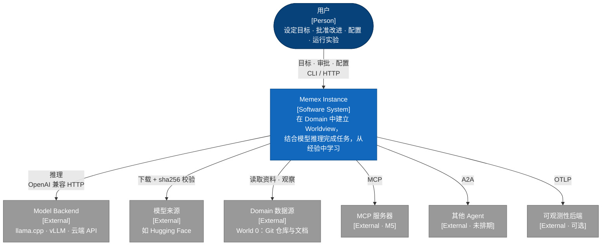
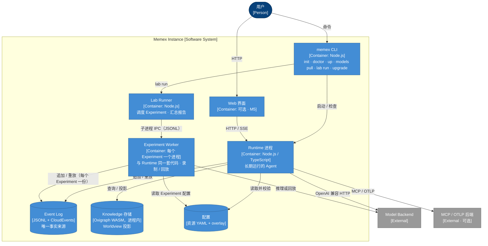
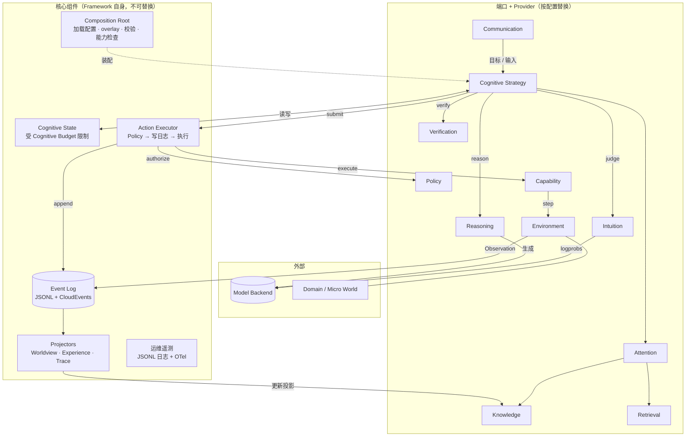
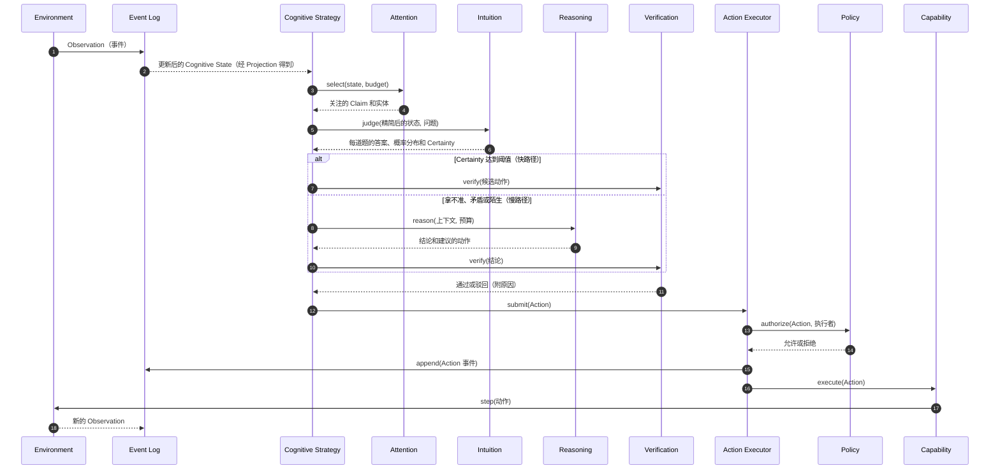

# 架构图（C4 模型）

本文件用 C4 模型描述 Memex 的架构。C4 是 Simon Brown 提出的分层画法，从粗到细依次为：System Context、Container、Component、Code。本文件只画前三层，外加一张动态图，展示一次认知步骤的执行过程。模块之间的集成契约见 [contracts.md](./contracts.md)。

- 图用 Mermaid 的 flowchart 绘制，GitHub 可以直接渲染。节点上标注了对应的 C4 元素类型，例如 [Person]、[Container]、[External]。没有使用 Mermaid 自带的 C4 语法：它目前仍是实验性的，而且实际渲染时自动布局会让连线标签互相重叠。
- C4 里的 "Container" 指**可以独立运行或部署的单元**，比如一个进程、一个数据存储，不专指 Docker 容器。
- 状态：草案 v0。它会在 M0 中通过实现来验证，在正式阶段关卡与 Cognitive Contract 一起冻结。

---

## 第 1 层：System Context

谁在使用 Memex，以及 Memex 依赖哪些外部系统。

---

## 第 2 层：Container

一个 Instance 由哪些可运行单元和数据存储组成。

要点：

- **Runtime 和 Experiment Worker 运行的是同一套代码**，区别只在配置和隔离方式。所以实验里验证过的东西，就是实际运行的东西。
- **Knowledge 存储默认在进程内运行**（Oxigraph WASM），因此不必单独部署。只有规模变大以后，才换成服务器模式。这只需要改配置。

---

## 第 3 层：Component（Runtime 内部）

虚线表示装配关系，实线表示调用或数据流。

规则：

- **核心组件**（Cognitive State、Action Executor、Event Log、Projectors、运维遥测）是 Framework 自己的代码，不可替换。
- **"端口 + Provider" 组件**通过契约接入（端口与适配器架构），可以通过配置替换。
- **Provider 之间互不调用。** 它们只经由 Strategy 或核心组件协作。Attention 调用 Knowledge 和 Retrieval，是 Strategy 授权它这样做的；这些调用通过契约里的 `StepContext.services` 完成，不直接引用其他 Provider 的实现。

---

## 动态图：一次认知步骤

每一步都会以事件的形式写入 Event Log，所以整个过程都可以重放、审计，并能生成 Trace。

## 来源
- [Mermaid C4 diagrams](https://mermaid.js.org/syntax/c4.html)
- [C4 model overview](https://docsio.co/blog/c4-model)
