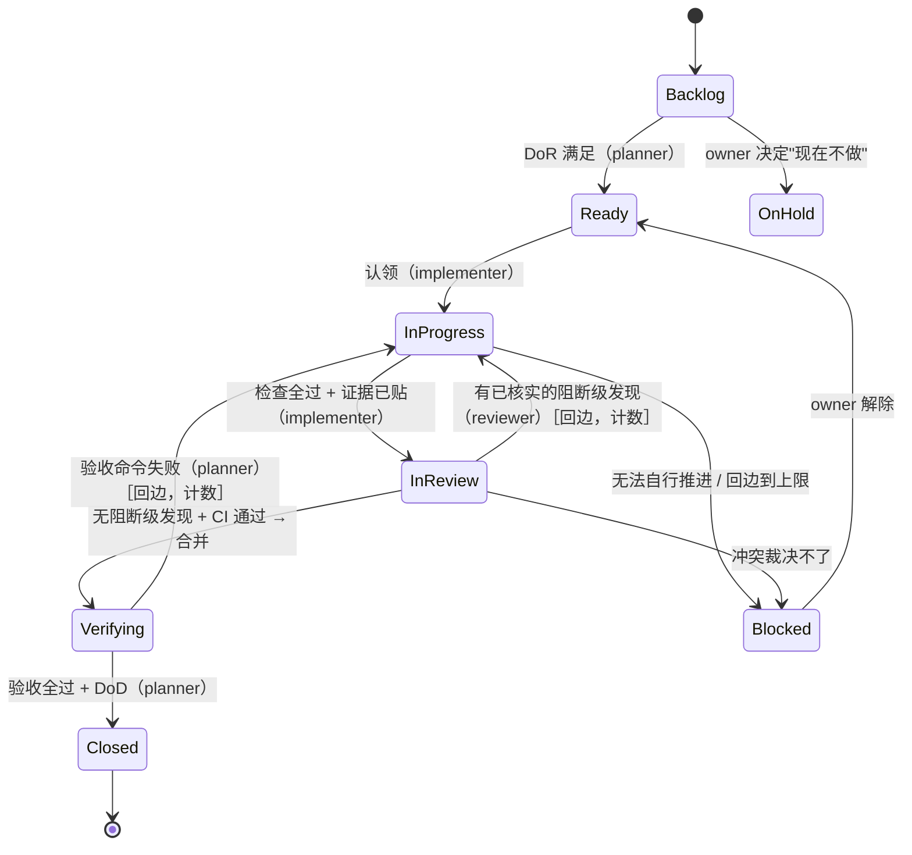

# 用 graph engineering 和 loop engineering 的概念检查并补齐 workflow 闭环

日期：2026-10-14。对象：一次"突击测试"——假设三个 agent（BA / planner、coding / implementer、review）按当前 playbook 运转，检查整个项目的 workflow 是否闭环；对发现的缺口，借鉴 graph engineering 和 loop engineering 的概念，看能否用现成的工具、格式或方法补齐。调研时仓库提交为 `a4eb970c`。本文只是调研记录，写入 playbook 前要先和负责人对齐理解。

可信度标记（沿用仓库约定）：**[官方/原文]**、**[官方/原文·摘要]**、**[二手]**、**[推断]**，含义见 `feedback-loop-2026-10-14.md`。

**关于新词**：loop engineering 和 graph engineering 是 2026 年的说法，定义不统一（见 `feedback-loop-2026-10-14.md`）。本文只借用它们的**概念**（节点、边、守卫条件、回边上限、上报、触发、验证、结果、改进），具体做法全部落到早已存在的通用方法上：工作流状态机、看板的显式策略、Specification by Example、代码审查规范、发布后的冒烟测试和事后复盘。

---

## 一、突击测试发现的缺口

把 playbook 的工作流按回路检查（见对话记录，2026-10-14）：

| 回路 | 闭合吗 | 断点 |
|---|---|---|
| A. 需求交付：需求 → story → 实现 → 验证 → 关闭 | 基本闭合 | 审查与验收的交接 |
| B. 质量反馈：发现 → 修复 → 再检查 | 基本闭合 | 审查与修复的往返没有上限 |
| C. harness 改进：重复问题 → 台账 → 新检查 → 复查检查 | 闭合 | — |
| D. 上线与生产反馈：关闭 → 发布 → 生产 → 事故 → 新 issue | **不闭合** | 没有发布这一段 |
| E. 决策：卡住 → blocked → owner 决定 → 记录 → 继续 | 闭合 | — |

与是否自动化无关的缺口：
1. 合并权和"审查 → 合并 → 验收"的顺序没有写。
2. 没有"审查中 / 待验收"状态，交接期间 issue 归谁不清楚。
3. 审查与修复的往返没有上限。
4. 没有发布和上线一段，生产问题回到 tracker 的路径只有一句话。
5. 验收测试由谁写：testing.md 要求非实现者写，delivery-planning 1.4 说 planner 不改代码，两条冲突。
6. 审查者没有可逐步执行的规程。
7. 项目进行中谁可以调整结构和契约，是否必须先写 ADR，没有写明。

只在全自动时才需要的：触发机制、用不同的模型做审查。

---

## 二、借来的概念

### 2.1 graph engineering：把工作流写成一张显式的图 [二手]

Analytics Vidhya 的实践定义：把系统写成可执行的图，明确节点、依赖、状态转换、验证关卡和恢复路径。与本文相关的要素：
- **节点**：可以是 agent、确定性函数、测试套件、评估者、人的审批。
- **边**：直接边、条件边、并行边、**回边**（修改和重试）、错误边、人控制的边、事件触发的边。
- **路由和守卫条件**：路由读取状态并选择允许的边；**硬约束写在路由里，不写在提示词里**。
- **验证关卡**：评估节点按证据检查产物，设置"通过"标记；审查输出用结构化格式。
- **恢复路径**：修改回路有**硬上限**；超过上限就**上报给人**；错误分类处理（瞬时错误重试、权限问题上报、违反策略就停）。
- **人的检查点**：在有后果的动作之前暂停，按风险决定放在哪里。
- **停止条件**：最大修改次数、终止节点、违反策略。
- **节点契约**：输入、输出、可用工具、超时、重试策略、副作用、失败类别、验证规则、负责人。
- 多数确定性的工作流，用普通的队列、数据库、调度器或状态机库就够了，不一定要 agent 框架。

PuppyOne 的补充：审查者不能改写它评判的产物；成功要用图外的证据判定；批准要绑定到具体的状态版本；多个相似 agent 的一致不是验证（见 `feedback-loop-2026-10-14.md` 3.1）。[二手]

### 2.2 loop engineering：每个回路有五个要素加记忆 [二手]

Augment 的整理（没有读到 Osmani 原文）：
1. **触发**：什么启动一次运行（PR 打开、告警、issue 进入某状态）。改触发是回路层面的修改，不是提示词层面的。
2. **执行**：每个专门的 agent 有自己的目标、工具和验收标准。
3. **验证**：先跑自动检查，人负责判断、批准或补充上下文；按风险决定是否每次都要人。
4. **结果**：明确"完成"的定义；没有交付出去的产出不算成功。
5. **改进**：用运行记录（trace）改进回路：哪里坏了，哪里需要人，哪里可以更顺。
- **记忆**：每次运行的记录供下次使用。
- 判断：输出错了时，先看该改触发、验收标准、验证还是人的位置；只改提示词是 prompt engineering。

Sonar、Developers Digest 补充：迭代上限、预算上限、成功退出；验证失败的项记录后跳过，不在原地重试（见 `feedback-loop-2026-10-14.md` 2.1）。[二手]

### 2.3 两个概念合起来，得到一个可检查的"闭环"定义 [推断]

把 workflow 画成图之后，"闭环"可以变成几条能逐条检查的性质：
1. 每个非终止状态至少有一条出边。
2. 每条边有守卫条件（谁、凭什么证据可以走这条边）。
3. 每条回边有上限；到达上限后有一条上报边，通向 owner。
4. 每个终止状态有验证者，验证用的证据来自图外（命令、测试、监控）。
5. 每个回路有触发、执行者、验证者、完成条件、上限、上报、记录去向七个字段。

这样，"workflow 是否闭环"就从一种感觉，变成了一张表能回答的问题。这正是本次突击测试要的东西。

---

## 三、可以直接用的通用方法和格式

### 3.1 工作流状态机：状态、转换、守卫 [二手]

- 状态表示 issue 处在流程的哪一步；转换是状态之间的连线；只有连线存在才能移动，整个工作流就是一张流程图。（Bentley 文档、ONES）
- 宽泛的状态可以拆开，例如把 "Code Review" 拆成 "In Review" 和 "Review Passed"。典型的软件工作流：backlog → in progress → code review → ready for QA → in QA → done。（Atlassian 社区）
- 守卫是转换上的条件。YouTrack 的建议：守卫阻止转换时要给出说明，不要静默失败——这和 feedback.md 第 1 节"消息写给读者看"一致。
- 主流 tracker（Jira、YouTrack、GitHub Projects 等）都支持自定义状态，部分支持守卫和自动化；没有守卫功能时，守卫写成文字规则，由验证者检查。[推断]

### 3.2 看板的显式策略：每列的进入和退出条件 [二手]

- 看板指南要求工作流定义包含"工作项如何在各状态间流动"的显式策略（转述，未读原文）。
- 每个边界一对规则：离开的列有**退出条件**，进入的列有**进入条件**；写成简短、可检查的一行，贴在看板上。
- **好的条件的检验**：两个人读同一张卡，得出同样的结论。"有验收标准、没有未决问题、构建通过"能过；含糊的措辞过不了。
- 没有写明条件时，"拉取"会退化成"抓一个看起来差不多的"，半成品流到下游，代价更大。
- 每列一个 DoD，还是所有转换条件合起来构成一个 DoD，两种做法都有，结果一样：每个转换都有可检查的标准。
- 工作在列之间来回跳时，收紧规则。

**对 playbook 的意义**：Definition of Ready 就是"ready"列的进入条件，Definition of Done 就是"closed"的进入条件。缺的是中间几个状态（审查中、待验收）的进入和退出条件。

### 3.3 Specification by Example / Gherkin：需求写成可执行的例子 [二手]

- Specification by Example 用具体例子描述需求，例子本身就是验收测试，也叫 ATDD、可执行需求。
- Gherkin（Given / When / Then）是业务人员能读的格式，能被测试工具执行。
- "Three Amigos"：BA、开发、测试在动工前一起澄清例子。
- 一位资深 BA 的经验：先把它当作**写需求的方法**，而不是测试自动化；第一次失败是因为和开发团队没有共同的约定。
- spec-driven development（GitHub Spec Kit、Kiro 等）在 2026 年很常见：spec 是事实来源，agent 从 spec 推出计划、任务和代码，再对照 spec 检查。批评者认为它可能是"换了名字的瀑布"，小脚本不值得。[二手]

**对缺口 5 的意义**：BA 写的是**需求的可执行形式**（场景文件或验收测试），不是产品代码。实现者只写把场景接到代码上的"粘合层"（step definitions）和产品代码。场景文件放在受保护路径里，含义由 BA 掌握；粘合层归实现者，靠审查和基线比较防止被写成永远通过。这样"planner 不改产品代码"和"验收测试不由实现者写"可以同时成立。是否引入 Gherkin 工具是可选的：不用 Gherkin 时，story 里带命令的验收标准、加上 planner 写的受保护验收测试文件，是同一个思路。[推断]

### 3.4 代码审查规范：审查看什么、什么时候批准 [官方/原文·摘要]（Google eng-practices）

- **看什么**：设计（最重要）、功能（对最终用户和以后的开发者）、复杂度、测试、命名、注释、风格、文档。
- **批准标准**：变更让整体代码健康度变好，就可以批准，不要求完美（"overall code health"的原文措辞未核对 [二手]）。
- **分歧的裁决顺序**：技术事实 > 风格指南 > 软件工程原则（不看个人偏好）> 与现有代码一致 > 上报 tech lead，不无限等待。[二手]
- 作者在提交审查前应该已经测试过；审查者不重复验证基本正确性。
- 原仓库据称已于 2025-11 归档为只读，静态网站仍可访问（未核实）。

**对缺口 6 的意义**：审查规程 = Google 的"看什么"清单 + feedback.md 的发现格式 + 项目的约束表和安全要求 + 批准标准 + 裁决顺序（与 feedback.md 第 3 节对齐）。

### 3.5 发布、发布后冒烟、回滚、事后复盘 [二手]，复盘部分 [官方/原文·摘要]

- **发布后冒烟测试**：广度不求深度，每个主要子系统一个简单检查；整套几分钟内完成；检查的是部署出来的系统（配置、密钥、路由、连接），这些是构建时测试看不到的；只让一个快的子集做关卡，其余作为观察信号；不碰真实的生产数据；失败就阻止，不能以"大概是不稳定"为由继续。
- **回滚**：用功能开关回滚比重新部署快；但开关**撤销不了数据库迁移和数据格式的变化**。
- **DORA 四个指标**：部署频率、变更前置时间、恢复时间、变更失败率。
- **事后复盘**（Google SRE）：记录影响、处置、根因、防止复发的后续行动。行动项没有关闭，等于默认可以再出一次同样的事故，而且业务越成功下次越严重。行动项要具体、可验证，有负责人、交付物、截止日期；"改进监控"太含糊，"某个具体告警和阈值"才可操作。

**对缺口 4 的意义**：发布这一段可以完全用现成做法补齐，而且能接上已有的部分：发布后冒烟 = practices 的 live-done；复盘的行动项 = issue（Task 8）；复盘的"防止复发" = 反馈台账的"预防"一栏和升级阶梯。

---

## 四、缺口与补法的对照 [推断]

| # | 缺口 | 借用的概念 | 现成的方法或格式 | 落在 playbook 哪里 |
|---|---|---|---|---|
| 1 | 合并权和顺序 | 条件边、守卫写在路由里、批准绑定状态版本 | 状态机 + 每列进入/退出条件；托管平台的分支保护和合并队列做守卫 | delivery-planning：状态表和 Task 7 |
| 2 | 缺"审查中/待验收"状态 | 显式节点，每个节点有负责人 | 把 "in progress → closed" 拆成 in review、verifying；每个状态写负责人和进入/退出条件 | 同上；epic 模板的状态值 |
| 3 | 审查往返没有上限 | 回边硬上限，超限上报给人 | 上限计数写在 issue 里；超限就标 blocked，交给 owner | feedback.md 第 3 节 |
| 4 | 没有发布一段 | 回路的五要素：触发、执行、验证、结果、改进 | 发布后冒烟、回滚方式（开关或重新部署；迁移另行处理）、事后复盘行动项转 issue | framework：新增"发布"（Phase 5）；checklist 新条目 |
| 5 | 验收测试由谁写 | 节点契约：谁拥有哪份产物；审查者不改产物 | Specification by Example：BA 写场景或验收测试（受保护），实现者写粘合层和代码；Gherkin 可选 | testing.md 第 2 节；delivery-planning 1.4 加例外 |
| 6 | 审查者没有规程 | 验证节点：结构化输出、按证据判定 | Google 代码审查规范的"看什么"和批准标准 + feedback.md 的发现格式 | 新增 review 规程（STE，参照 delivery-planning） |
| 7 | 结构和契约的修改权 | 守卫条件：改结构走哪条边 | ADR（已有）；把"改结构或契约"设为需要 ADR 或 issue 理由的转换 | framework Phase 5 角色；Phase 6 变更流程 |
| — | 闭环本身怎么检查 | 图的性质：每个状态有出边、回边有上限、上限通向上报、终点有图外验证 | 一张"工作流图"（Mermaid stateDiagram，主流平台都能渲染）+ 一张转换表；每个回路一张"回路卡"（七个字段） | delivery-planning 或 framework 新增一节；checklist 新条目"工作流闭环检查" |

### 4.1 建议的工作流图（示意）[推断]

发布回路（Closed 之后）单独一张回路卡：触发（合并到主干或打发布标签）→ 部署 → 发布后冒烟（关卡）→ 观察 → 出事故则回滚 + 复盘 → 行动项成为 issue → 进入 Backlog。

### 4.2 回路卡（七个字段）[推断，字段来自 2.2 和 2.1]

| 字段 | 含义 |
|---|---|
| 触发 | 什么事件或时间启动这个回路 |
| 执行者 | 哪个角色（人或 agent） |
| 验证者与证据 | 谁判定，凭什么图外证据 |
| 完成条件 | 什么算完成（交付出去，不只是产出） |
| 上限 | 最多几轮或多少预算 |
| 上报 | 到上限或裁决不了时交给谁 |
| 记录去向 | 结果和教训写到哪里（issue、反馈台账） |

playbook 里已有的回路都可以填进这张卡：会话内回路、审查回路、验收回路、发布回路、harness 改进回路、交付健康回路。填不满的字段就是缺口。

---

## 五、不建议采用的

- **agent 编排框架**（LangGraph、Google ADK、Microsoft Agent Framework 等）：解决的是"自动运行"，不是"workflow 是否闭环"；而且是特定技术栈，不满足通用性。playbook 只需要图的**概念**和一张图。
- **DORA 指标作为必做项**：有用，但需要部署流水线和数据，适合作为发布回路里的可选健康信号（Recommended、W1）。
- **完整的 Gherkin 工具链作为必做项**：只把"需求写成可执行的例子、由非实现者掌握"作为原则；工具可选。

## 六、待核实

- 看板指南中"显式策略"的原文措辞。
- Google eng-practices "The Standard of Code Review" 页的原文和仓库归档状态。
- Google SRE 复盘行动项文章的全文。
- Osmani 的 loop engineering 原文。

---

## 来源

graph / loop engineering：
- [Analytics Vidhya: Graph Engineering for AI Agents](https://www.analyticsvidhya.com/blog/2026/07/graph-engineering/)
- [PuppyOne: What Is Graph Engineering for AI Agents?](https://www.puppyone.ai/en/blog/graph-engineering-ai-agents-map)
- [Augment: What is loop engineering](https://www.augmentcode.com/guides/what-is-loop-engineering)
- [Sonar: Loop engineering without verification is just automation](https://www.sonarsource.com/blog/loop-engineering-without-verification-is-just-automation/)

工作流状态机与看板策略：
- [Bentley: Stepping Through an Issue Workflow](https://developer.bentley.com/tutorials/stepping-through-an-issue-workflow/)
- [YouTrack: State-machine rules](https://www.jetbrains.com/help/youtrack/devportal/state-machine-per-issue-type.html.md)
- [Atlassian community: workflow statuses](https://community.atlassian.com/forums/Jira-questions/workflow-statuses/qaq-p/3022556)
- [ProKanban: column policies](https://prokanban.org/portfolio-playbook/column-policies)
- [CodeSignal: Making Policies Explicit](https://codesignal.com/learn/courses/kanban-and-flow-optimization/lessons/making-policies-explicit)
- [Scrum.org: Definition of Done for each Kanban state?](https://www.scrum.org/node/34082)

Specification by Example 与 spec-driven development：
- [Manning: Writing Great Specifications, ch.1](https://livebook.manning.com/book/writing-great-specifications/chapter-1/ch01fig05)
- [DZone: Specification by Example with Gherkin](https://dzone.com/articles/3-ways-specification-by-example-with-gherkin-reduc)
- [IRM UK: a senior BA on Gherkin](https://irmuk.co.uk/?p=8047)
- [GitHub Spec Kit guide](https://intuitionlabs.ai/articles/spec-driven-development-spec-kit)
- [Spec-Driven Development in 2026: Future or Waterfall 2.0?](https://alexcloudstar.com/blog/spec-driven-development-2026/)

代码审查：
- [Google eng-practices: Code Review](https://google.github.io/eng-practices/review/)
- [Google eng-practices: What to look for in a code review](https://google.github.io/eng-practices/review/reviewer/looking-for.html)

发布与复盘：
- [Flagsmith: Smoke testing](https://flagsmith.com/blog/smoke-testing)
- [Harness: Smoke testing in CI/CD](https://www.harness.io/harness-devops-academy/integrating-smoke-testing-into-your-ci-cd-pipeline-what-devops-needs-to-know)
- [Spotify Confidence: rollback](https://confidence.spotify.com/glossary/rollback)
- [Postmortem Action Items: Plan the Work and Work the Plan（Google Research）](https://research.google/pubs/pub45906/)
- [incident.io: Why post-mortem action items fail](https://incident.io/blog/why-do-post-mortem-action-items-fail-how-to-make-incident-follow-ups-actually-get-done)
