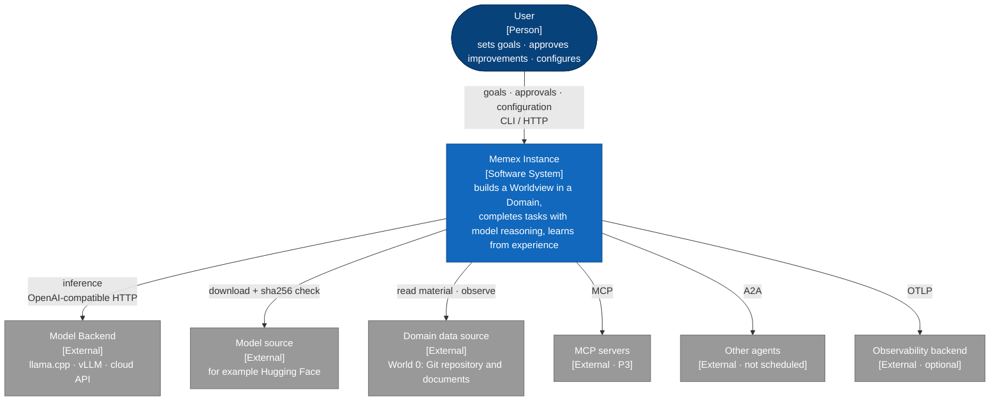
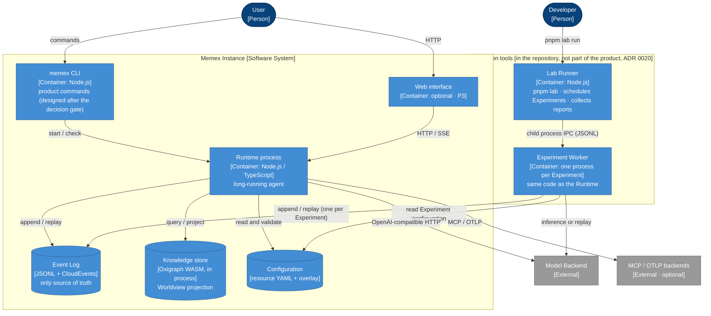
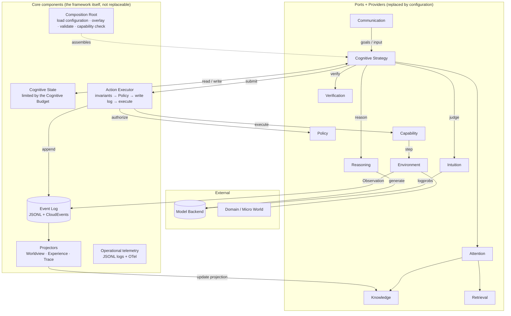
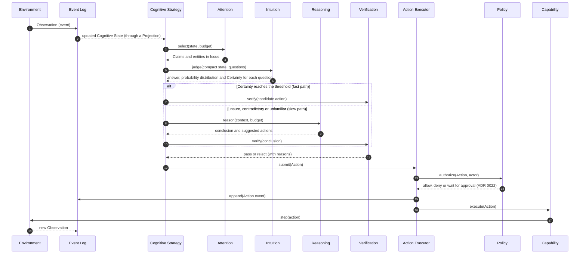

# Architecture diagrams (C4 model)

This file describes the architecture of Memex with the C4 model. C4 is the layered notation of Simon Brown, from coarse to fine: System Context, Container, Component, Code. This file draws only the first three levels, plus one dynamic diagram that shows how one cognitive step runs. For the integration contracts between modules, see [contracts.md](./contracts.md).

- The diagrams are Mermaid flowcharts, which GitHub renders directly. Each node is labeled with its C4 element type, for example [Person], [Container], [External]. The built-in Mermaid C4 syntax is not used: it is still experimental, and its automatic layout makes link labels overlap when rendered.
- A "Container" in C4 means **a unit that can run or be deployed on its own**, such as a process or a data store. It does not mean a Docker container specifically.
- Status: draft v0. V0 verifies it through implementation, and it is frozen together with the Cognitive Contract at the decision gate.

---

## Level 1: System Context

Who uses Memex, and which external systems Memex depends on.

---

## Level 2: Container

Which runnable units and data stores make up one Instance.

Main points:

- **The Runtime and the Experiment Worker run the same code.** They differ only in configuration and isolation. So what is verified in experiments is what actually runs.
- **The Knowledge store runs in process by default** (Oxigraph WASM), so it needs no separate deployment. Only when the scale grows does it switch to server mode, which is only a configuration change.

---

## Level 3: Component (inside the Runtime)

Dotted lines are assembly; solid lines are calls or data flow.

Rules:

- **The core components** (Cognitive State, Action Executor, Event Log, Projectors, operational telemetry) are the framework's own code and cannot be replaced.
- **The "port + Provider" components** connect through the contracts (ports and adapters architecture) and can be replaced by configuration.
- **Providers do not call each other.** They work together only through the Strategy or the core components. Attention calls Knowledge and Retrieval because the Strategy grants it. These calls go through `StepContext.services` in the contracts, without referring directly to the implementation of another Provider.

---

## Dynamic diagram: one cognitive step

Each step is written to the Event Log as an event, so the whole process can be replayed and audited, and can produce a Trace.

## Sources
- [Mermaid C4 diagrams](https://mermaid.js.org/syntax/c4.html)
- [C4 model overview](https://docsio.co/blog/c4-model)
